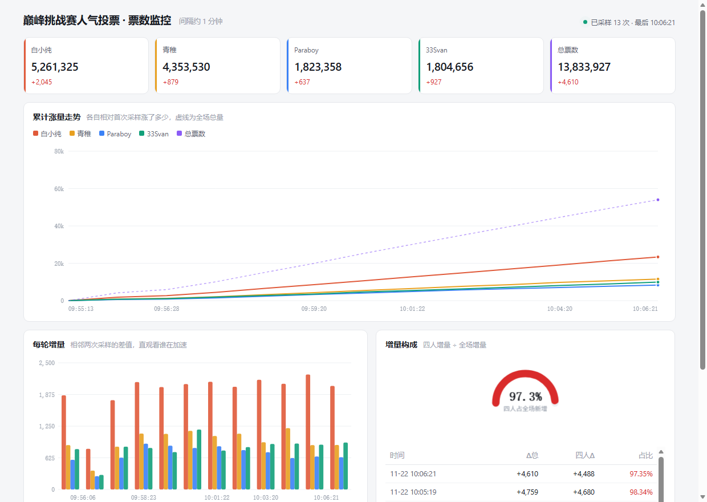
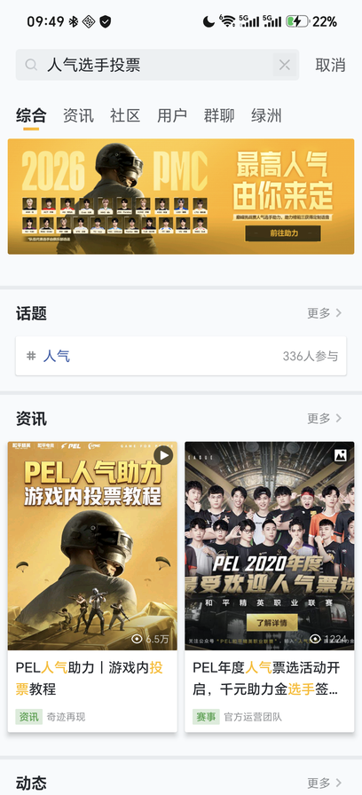

# 和平营地 · 人气投票票数采集器

自动记录「巅峰挑战赛人气投票」页面上的票数，每分钟一次，输出 CSV 和实时涨幅看板。

适合谁用：想看清某场投票活动里，几个候选人票数怎么涨、涨得有多快、增量集中在谁身上。



---

## 目录

- [它解决什么问题](#它解决什么问题)
- [两种用法，挑一个](#两种用法挑一个)
  - [方式一：下载 exe，双击运行](#方式一下载-exe双击运行最省事)
  - [方式二：跑源码](#方式二跑源码)
- [第一步：把手机连上电脑](#第一步把手机连上电脑)
- [第二步：开始采集](#第二步开始采集)
- [看懂数据](#看懂数据)
- [常见问题](#常见问题)
- [改成采集你自己的页面](#改成采集你自己的页面)
- [工作原理](#工作原理)
- [免责声明](#免责声明)

---

## 它解决什么问题

这类投票页面有个共同点：**数据不会自己刷新**。你得退出页面再进来，它才会重新拉一次票数。

肉眼看一次，只能知道「现在是多少」。想看「涨得多快」，就得隔几分钟手动进进出出，记在本子上——坚持不了半小时。

这个工具把这件事自动化：

| 环节 | 怎么做 |
|---|---|
| 刷新 | 每轮自动退出活动页、重新点进去 |
| 读数 | 截图后本地 OCR 识别数字，不用联网 |
| 存数据 | 追加写入 `votes.csv`，带增量列 |
| 看趋势 | 本地网页看板，每 15 秒自动刷新 |

跑起来之后你可以去干别的事，晚上回来打开看板，一天的涨幅曲线就在那儿。

**关于识别方式的选择**：这个页面是嵌在 App 里的网页（WebView），安卓的无障碍接口读不到里面的文字，所以走 OCR 是唯一稳定的路子。想抓数据接口也能做，前提是能拿到带正确签名的接口地址，成功率看 App 的实现，这个工具不去碰它。

---

## 两种用法，挑一个

### 方式一：下载 exe，双击运行（最省事）

1. 打开 [Releases](../../releases) 页面
2. 下载最新的 `VoteTracker.exe`
3. 把 exe 放到一个**固定的文件夹**里，比如 `D:\VoteTracker\`
   - 它会在这个文件夹旁边生成 `votes.csv` 和 `shots\` 目录
   - 别放在桌面或临时目录，容易被误删
4. **先把手机连好**（见[第一步](#第一步把手机连上电脑)）
5. 双击 `VoteTracker.exe`

黑窗口会依次打印四步进度，然后自动打开浏览器显示看板。窗口别关，关掉就停止采集了。

首次启动可能要等 10~20 秒，exe 体积大，解压需要时间。

### 方式二：跑源码

需要 Python 3.10 以上。

```bash
# 1. 装依赖
pip install -r requirements.txt

# 2. 确认手机已连接
adb devices

# 3. 一键启动（采集 + 看板 + 自动开浏览器）
python app.py

# 或者分开跑
python vote_scraper.py --interval 60      # 只采集
python serve_dashboard.py                 # 只起看板，浏览器开 http://127.0.0.1:8770/
```

只采集、不看网页也行，数据照样进 `votes.csv`。

---

## 第一步：把手机连上电脑

这一段是整个流程里最容易卡住的，耐心看完。

### 1. 打开开发者选项

设置 → 关于手机 → 找到「版本号」→ **连着点 7 次** → 输入锁屏密码 → 提示「您已处于开发者模式」

华为/荣耀手机在「设置 → 关于手机 → 版本号」，小米在「设置 → 我的设备 → 全部参数 → MIUI 版本」。

### 2. 打开 USB 调试

设置 → 系统与更新（或「系统和更新」）→ 开发人员选项 → 找到 **「USB 调试」** → 打开

> 华为/荣耀注意：可能还有一个「仅充电模式下允许 ADB 调试」，一起打开。

### 3. 插线并授权

用数据线把手机连到电脑，手机会弹「是否允许 USB 调试」，点**「允许」**，勾上「一律允许」。

如果没弹窗，拔掉重插一次。还不行就换根线——**只能充电的线是没有数据传输功能的**，这是最常见的坑。

### 4. 验证

在命令行执行：

```bash
adb devices
```

看到类似这样的输出就算成功：

```
List of devices attached
AHPBVB3220016151        device
```

关键看最后一列，必须是 `device`。如果显示 `unauthorized`，说明手机上的授权弹窗没点允许；如果是 `offline`，拔插一次。

### 5. 华为/荣耀用户额外一步（如果 adb devices 是空的）

现象：设备管理器里能看到「ADB Interface」，驱动也正常，但 `adb devices` 死活看不到设备。

原因：Windows 用通用 WinUSB 驱动接管了这个接口，而 adb 靠一个特定的设备接口 GUID 找设备，通用驱动不会写这个值。

修复：双击 `tools\fix_adb_driver.bat`，弹 UAC 点「是」，等它跑完。

脚本会做三件事：写入那个 GUID、重启设备、重启 adb 服务。跑完再执行一次 `adb devices`。

这个脚本改的是注册表里一个多字符串值，想撤销就删掉那一项，不影响其他设备。

> 这个坑是实测踩出来的，具体原理见 [docs/adb-windows-notes.md](docs/adb-windows-notes.md)。

---

## 第二步：开始采集

手机连好之后，双击 `VoteTracker.exe` 或执行 `python app.py`。

启动后手机会**自动**发生这些动作，你只需要把它放在一边别动：

1. 打开和平营地
2. 点进活动页
3. 截两张图
4. 识别票数
5. 退回，等 60 秒
6. 重复

**第一次用需要手动准备一次**：打开和平营地，搜索框输入「人气选手投票」，进到活动页，然后**退回到这个搜索页**再启动程序。程序会记住这个位置，之后每轮自己进出。

检查点：手机停在搜索页，页面上能看到那个活动横幅广告。这个状态就对了。

<table>
<tr>
<td width="50%">

**起点：搜索页**

程序会点这个横幅（红框区域）进活动页



</td>
<td width="50%">

**目标：活动页**

进去后等页面加载完，截图读票数，然后按返回键退出


</td>
</tr>
</table>


### 参数调整

exe 用环境变量控制，源码用命令行参数。

| 想改什么 | exe（环境变量） | 源码（命令行） |
|---|---|---|
| 采集间隔 | `set SCRAPE_INTERVAL=30` | `--interval 30` |
| 截图留档 | `set SAVE_SHOTS=need` | `--save need` |
| 看板端口 | `set DASHBOARD_PORT=8771` | `python serve_dashboard.py 8771` |

截图留档三档：

- `all` —— 每轮都存，一小时约 15 MB
- `need` —— 只在读数可疑时存，几乎不占空间
- `none` —— 完全不存

存下来的截图会裁掉无关区域再转 JPEG，单张约 100~140 KB（原图 2.4 MB）。票数、选手名、倒计时都完整保留，翻回去核对很方便：


环境变量要在**同一个命令行窗口**里 set，然后从那个窗口启动 exe：

```bat
set SCRAPE_INTERVAL=30
set SAVE_SHOTS=need
VoteTracker.exe
```

### 怎么停

- 关掉黑窗口
- 或者按 `Ctrl + C`
- 数据都在 `votes.csv` 里，中途停了不影响，下次启动会接着往里追加

---

## 看懂数据

### CSV 字段

`votes.csv` 用 Excel 直接打开，第一行是表头：

| 字段 | 含义 |
|---|---|
| 时间 | 采样时刻，精确到秒 |
| 总票数 | 页面上「所有玩家总投票数」 |
| 白小纯 / 青稚 / Paraboy / 33Svan | 前四名的票数 |
| Δ总 | 相对上一次采样，全场新增了多少票 |
| 四人Δ合计 | 前四名增量之和 |
| 四人Δ占比% | `四人Δ合计 ÷ Δ总`，核心指标 |

**为什么要算「四人Δ占比」**：这个数字接近 100% 意味着全场新增的票几乎全进了这四个人口袋，其余所有候选人加起来只分到零头。它能直观反映投票行为有多集中。占比长期稳定在 97%~99%，说明增量来源很固定。

### 看板

浏览器打开 `http://127.0.0.1:8770/`，三个区块：

1. **累计涨量走势** —— 以第一次采样为基准，四条曲线各自涨了多少。虚线是全场总增量，用来对比
2. **每轮增量** —— 相邻两次采样的差值柱状图，谁在加速一眼看得出
3. **增量构成** —— 半环图显示最新一次的「四人Δ占比」，下面附最近 40 轮明细表

看板每 15 秒自动拉一次新数据，采集在跑就会自己更新。

---

## 常见问题

**双击 exe 闪一下就没了**

说明启动时报错了。打开命令行，`cd` 到 exe 所在目录，执行 `VoteTracker.exe`，这样错误信息不会消失，能看清原因。

**提示「手机没连上」**

回到[第一步](#第一步把手机连上电脑)逐条检查。最常见的原因是线只能充电、USB 调试没开、手机上的授权弹窗没点。

**识别出来的数字明显不对**

页面在加载中截了图。程序已经做了两帧比对确认加载完成，偶尔还是会漏。去 `shots\` 看那一轮的截图，画面还停在骨架屏或白屏就属于这种情况。降低采集频率（间隔改 90 秒）能减少概率。

**第二排数字读不出来**

页面底部有悬浮栏带渐变压暗，会盖住第二排票数的下半截。程序的处理方式是截两张图：先回到页面顶部截一张读第一排，再往上滑 800px 截一张读第二排。如果你的手机屏幕比例不同导致滑动量不够，去 `scraper_config.json` 调 `swipe_up` 的起点终点。

**采集期间手机还能用吗**

不能。程序一直在进出活动页，你手动操作会打乱它。想用手机就先停采集。

**能同时采集多个页面吗**

当前版本跑的是单页面、单设备。要多开就把整个文件夹复制一份，改端口和配置分开跑。

**电脑关机了怎么办**

数据不会丢，`votes.csv` 里已有的都在。重新双击启动，接着往后记。时间轴上会有一段空缺，看板上能看到。

---

## 改成采集你自己的页面

这个工具的三个部分都可以独立替换：

**1. 换点击坐标**

打开 `scraper_config.json`（第一次运行后会在程序目录生成，也可以从仓库里的 `scraper_config.example.json` 复制）：

```json
{
  "tap_ad": [612, 660],
  "swipe_up": [612, 2100, 612, 1300, 500],
  "swipe_down": [612, 1100, 612, 2300, 250],
  "crop_top": [0, 850, 1224, 1850],
  "crop_bottom": [0, 900, 1224, 1700]
}
```

坐标基于 **1224×2688** 这个分辨率标定，程序会按你的实际分辨率自动缩放。量坐标的方法：截图后用看图软件看像素位置，或者用 `/dry-run` 模式跑一次，看 `shots/` 里截到了什么。

**2. 换识别的字段**

改 `vote_scraper.py` 里的 `PLAYERS` 列表：

```python
PLAYERS = [
    ("白小纯", "r1l"),      # (页面上出现的文字, 字段名)
    ("青稚", "r1r"),
    ("Paraboy", "r2l"),
    ("33Svan", "r2r"),
]
```

提取逻辑是「以这段文字为锚点，取它下方 25~175 像素、同一半屏内置信度最高的数字」。换成任何「名字 + 下方数字」的布局都能用。

**3. 换看板的显示**

`dashboard.html` 是单文件，内联了全部 CSS 和 JS，Canvas 手绘图表，零外部依赖。改 `SERIES` 数组里的名字和颜色即可。

---

## 工作原理

```
┌─────────────┐   input tap    ┌──────────────┐
│  搜索页      │ ──────────────>│  活动页       │
│ (横幅广告位)  │                │  (WebView)   │
└─────────────┘                └──────────────┘
       ↑                              │
       │  keyevent BACK               │  screencap
       └──────────────────────────────┤
                                      ↓
                            ┌──────────────────┐
                            │  dhash 两帧比对    │
                            │  确认渲染完成      │
                            └──────────────────┘
                                      │
                                      ↓
                            ┌──────────────────┐
                            │  裁两张图          │
                            │  A: 顶部 / B: 下滑后│
                            └──────────────────┘
                                      │
                                      ↓
                            ┌──────────────────┐
                            │  RapidOCR 本地识别 │
                            │  锚点定位票数       │
                            └──────────────────┘
                                      │
                                      ↓
                          votes.csv ──> 看板
```

几个关键设计：

- **判断加载完成**：连续截两帧算感知哈希，汉明距离小于等于 2 就认为画面稳定了。比固定 sleep 可靠，页面慢的时候不会截到半成品。
- **两张截图**：底部悬浮栏会挡住第二排票数，滑一段再截一张解决。
- **锚点定位**：按选手名找票数位置，不写死 y 坐标，滚动量有偏差也能对齐。
- **OCR 本地跑**：RapidOCR（PP-OCRv4 的 ONNX 版本），不联网，不上传任何图片。

依赖清单见 [requirements.txt](requirements.txt)。

---

## 免责声明

这个工具通过安卓官方的调试接口读取你自己手机屏幕上的公开数据，用途是个人化的数据观察。

需要注意：

- 它每 60 秒访问一次活动页，行为模式接近真人浏览，**高频重复访问仍可能被平台的风控策略注意到**。把间隔调到 90~120 秒更稳妥。
- 请勿用于刷票、代投或任何破坏活动公平性的用途。
- 使用产生的后果由使用者自行承担。

代码 MIT 协议开源，随便改。

---

## License

MIT
